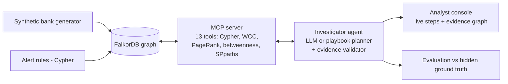

# RingBreaker

**An investigator agent that turns a bank's noisy fraud alerts into confirmed rings, frozen accounts and evidence you can follow, using a FalkorDB graph.**

Hackathon track: **Track 01: Agents That Act on Connected Data** (Graph Hacks by WeMakeDevs × FalkorDB).

---

## The problem

Banks flag suspicious activity with rule-based transaction monitoring. Each rule looks at one account at a time ("8+ senders", "money in and out within 24 hours"). Industry reports put the false-positive rate of these alerts above 90%. Analysts spend hours per alert pulling statements by hand, while the real criminals operate as networks:

- **Money-mule networks** cash out authorised-push-payment (APP) scams. Victims pay a collector, the collector splits the money across layering mules, and a cash-out account buys crypto or gift cards.
- **Round-tripping** cycles the same funds through shell companies to fake turnover.
- **Synthetic-identity bust-outs** use fabricated customers who share phones, addresses and devices. They age their accounts and drain them all on the same day.

None of these is visible from a single account. All of them are obvious in a graph.

## What RingBreaker does

Given an alert, the agent:

1. **Investigates over the graph.** It profiles the account, pivots on shared devices, IPs, phones and addresses, runs WCC to find identity clusters, follows time-ordered money paths, detects loops, and ranks ring roles with PageRank and betweenness.
2. **Chooses its tools through MCP.** All graph access goes through a fixed catalogue of reviewed Cypher queries and algorithms served by an MCP server. The model never writes Cypher.
3. **Acts on what the graph shows.** It opens a case, records findings, freezes accounts (gated by a risk policy), or closes the alert as a false positive with a documented reason.
4. **Explains every claim.** Each tool returns the nodes and edges that prove its result. The final verdict is validated so it may cite only entities the graph actually returned, and the UI draws those paths.
5. **Remembers.** Cases, findings and actions are written back into the graph, so the next investigation that touches a known account starts from them.



## Results

`python -m ringbreaker.evaluate --seed N` rebuilds the bank, investigates every open alert and scores each verdict against a ground-truth file the agent never sees.

| Seed | Alerts raised | Rings caught | Rings missed | False-positive accounts cleared | Innocent escalated | Accounts frozen (innocent) |
| --- | --- | --- | --- | --- | --- | --- |
| 7 | 127 | 8 of 8 | 0 | 26 | 0 | 45 (0) |
| 11 | 117 | 8 of 8 | 0 | 28 | 0 | 43 (0) |
| 23 | 128 | 8 of 8 | 0 | 27 | 0 | 47 (0) |
| 42 | 125 | 8 of 8 | 0 | 26 | 0 | 47 (0) |

These are results for the deterministic playbook planner. On every seed, a single alert uncovered 100% of its ring's accounts, and the typology was labelled correctly 8 of 8 times. The data is synthetic and modelled on the typologies below, so these numbers show the method works on those patterns. They are not a claim about real bank data.

## Graph data model

**Nodes**

| Label | Key properties | Purpose |
| --- | --- | --- |
| `Person` | name, segment, kyc_date | Customer who owns accounts |
| `Account` | type, opened, status (active / frozen), balance | Where money sits and moves |
| `Device` | os | Device fingerprint; an operator running many mules shows up as one device |
| `IP` | asn, kind (residential / mobile / vpn / hosting) | Network origin |
| `Phone` | number | Identity element |
| `Address` | line, city | Identity element; separates a household from a mail drop |
| `Merchant` | name, category, risk | Where money leaves the bank (crypto, gift cards, remittance = cash-out) |
| `Alert` | rule, detail, status, disposition | Output of the alert rules; the agent's input |
| `Case` | typology, risk, summary, status | Written by the agent for a confirmed ring |
| `Finding` | text, created | Evidence the agent recorded; long-term memory |
| `Action` | kind, status, reason | Audit trail of what the agent did |

**Relationships**

| Pattern | Properties |
| --- | --- |
| `(Person)-[:OWNS]->(Account)` | |
| `(Person)-[:HAS_PHONE]->(Phone)` | |
| `(Person)-[:LIVES_AT]->(Address)` | |
| `(Account)-[:USED_DEVICE]->(Device)` | |
| `(Account)-[:ACCESSED_FROM]->(IP)` | |
| `(Account)-[:TRANSFER]->(Account)` | id, amount, ts, channel; one edge per payment |
| `(Account)-[:PAID]->(Merchant)` | amount, ts |
| `(Alert)-[:FLAGS]->(Account)` | |
| `(Case)-[:RAISED_FROM]->(Alert)` | |
| `(Case)-[:INCLUDES]->(Account)` | |
| `(Case)-[:HAS_FINDING]->(Finding)-[:ABOUT]->(any)` | |
| `(Case)-[:TOOK]->(Action)-[:ON]->(Account)` | |

Identity elements are nodes, not properties, so "who else uses this device?" is one hop. Transfers are individual timestamped edges, so a money trace can require each hop to happen after the previous one. The agent's own output lives in the same graph, which is what gives it memory across sessions.

## Synthetic data

All data is generated (`ringbreaker/generator.py`, seeded): 2,400 ordinary customers over 90 days, plus planted patterns from public FATF / FinCEN typologies and benign look-alikes that trip the same rules.

| Pattern | Count | Real or benign |
| --- | --- | --- |
| APP-scam money-mule network (victims → collector → structured layering → cash-out → crypto; mules share emulators and a VPN IP) | 4 | Criminal |
| Round-tripping loop between shell companies at one address | 2 | Criminal |
| Synthetic-identity bust-out (shared phones, addresses, one PC; same-day drain to a sink) | 2 | Criminal |
| Families sharing a home router and tablet | 6 | Benign |
| Payroll fan-out | 4 | Benign |
| Landlords collecting rent | 3 | Benign |

The answer key is written to `data/ground_truth.json` and is only read by the evaluation script.

## Alert rules

`ringbreaker/monitoring.py` plays the bank's existing rule engine. On seed 7 it raises 127 alerts on 82 accounts, catching 56 of the 58 criminal accounts and 26 innocent ones.

| Rule | Fires when |
| --- | --- |
| RAPID_MOVEMENT | ≥ 20,000 in and ≥ 80% out again within 24 h |
| STRUCTURING | ≥ 3 transfers between 9,000 and 9,999 |
| FAN_IN | ≥ 8 distinct senders |
| SHARED_DEVICE | One device used by accounts of ≥ 3 different customers |
| HIGH_RISK_MERCHANT | > 50,000 spent at crypto, gift-card or remittance merchants |

## Tools (served over MCP)

Every tool is a fixed query in `ringbreaker/tools.py`. Ids are resolved against the graph before any query runs, reads use `ro_query`, and every result carries `evidence` (node ids and edges).

| Tool | Graph technique |
| --- | --- |
| `get_alert` | 1-hop match |
| `account_profile` | Aggregation over `TRANSFER` and `PAID` (age, pass-through ratio, merchants) |
| `prior_knowledge` | Earlier `Case` / `Finding` / frozen status on the entities |
| `shared_identifiers` | 2-hop pivots through `Device`, `IP`, `Phone`, `Address` |
| `identity_cluster` | `algo.WCC` over the identity subgraph |
| `follow_money` | Variable-length, time-ordered `TRANSFER` paths |
| `find_cycles` | `(a)-[:TRANSFER*2..7]->(a)` |
| `rank_roles` | `algo.pageRank` + `algo.betweenness` + in-ring flows |
| `explain_connection` | `algo.SPpaths` (either direction, ≤ 6 hops) |
| `open_case`, `record_finding`, `freeze_accounts`, `close_alert` | Writes; freezing requires case risk ≥ 0.8 |

### Key Cypher

Time-ordered money trace (`follow_money`):

```cypher
MATCH p = (a:Account {id: $id})-[:TRANSFER*1..3]->(x:Account)
WITH p, relationships(p) AS r
WHERE all(e IN r WHERE e.amount >= $min)
  AND all(i IN range(0, size(r) - 2)
          WHERE r[i+1].ts >= r[i].ts AND r[i+1].ts - r[i].ts <= $window)
RETURN [n IN nodes(p) | n.id] AS path,
       [e IN r | {from: startNode(e).id, to: endNode(e).id, amount: e.amount, ts: e.ts}] AS hops
```

Identity cluster (`identity_cluster`):

```cypher
CALL algo.WCC({nodeLabels: ['Account','Person','Device','Phone','Address'],
               relationshipTypes: ['OWNS','USED_DEVICE','HAS_PHONE','LIVES_AT']})
YIELD node, componentId
```

Shared identifiers (`shared_identifiers`, one of four branches):

```cypher
MATCH (a:Account {id: $id})-[:USED_DEVICE]->(x:Device)<-[:USED_DEVICE]-(b:Account)
RETURN 'Device' AS kind, x.id AS identifier, x.os AS info, b
```

Money loops (`find_cycles`):

```cypher
MATCH p = (a:Account {id: $id})-[:TRANSFER*2..6]->(a)
RETURN [e IN relationships(p) | {from: startNode(e).id, to: endNode(e).id, amount: e.amount, ts: e.ts}] AS hops
```

Role ranking (`rank_roles`):

```cypher
CALL algo.pageRank('Account', 'TRANSFER') YIELD node, score
CALL algo.betweenness({nodeLabels: ['Account'], relationshipTypes: ['TRANSFER']}) YIELD node, score
```

How two entities connect (`explain_connection`):

```cypher
MATCH (a {id: $a}), (b {id: $b})
CALL algo.SPpaths({sourceNode: a, targetNode: b, relDirection: 'both', maxLen: 6, pathCount: 3})
YIELD path
```

## The agent

`ringbreaker/agent.py` starts the MCP server, lists its tools and runs a planner:

- **LLM planner.** It picks tools by function calling through any OpenAI-compatible endpoint: Gemini (default), Groq or OpenRouter. It follows an analyst procedure and is capped at 18 tool calls. Its verdict is rejected if it cites any id that no tool returned.
- **Playbook planner** (`ringbreaker/playbook.py`). The same procedure as deterministic code with a transparent additive risk score. It is used when no LLM key is set, and it is the baseline the LLM is compared with.

Risk ≥ 0.8 means ring confirmed: open a case, record findings, freeze, escalate. Risk 0.5 to 0.8 means suspicious: open a case and recommend a freeze for an analyst. Below 0.5 means false positive: close the alert with the reason.

## Run it locally

Requirements: Docker and Python 3.11 or newer.

```bash
docker run -d -p 6379:6379 -p 3000:3000 --name falkordb falkordb/falkordb
python3 -m venv .venv && source .venv/bin/activate
pip install -r requirements.txt
export FALKORDB_HOST=localhost

python -m ringbreaker.load                 # build the bank, load FalkorDB, raise alerts
uvicorn ringbreaker.web.app:app --port 8000   # analyst console at http://localhost:8000
python -m ringbreaker.evaluate             # score against ground truth
```

The FalkorDB Browser at http://localhost:3000 can run every query above.

Optional LLM planner (otherwise the playbook runs):

```bash
export GEMINI_API_KEY=...        # or GROQ_API_KEY / OPENROUTER_API_KEY
export RB_LLM_PROVIDER=gemini    # optional; RB_MODEL overrides the model name
```

FalkorDB Cloud: set `FALKORDB_HOST`, `FALKORDB_PORT`, `FALKORDB_USERNAME` and `FALKORDB_PASSWORD` to your instance, and `FALKORDB_SSL=true` if the instance requires TLS. These can go in a git-ignored `.env` file in the project root.

Use the MCP server from any MCP client:

```bash
python -m ringbreaker.mcp_server          # stdio
python -m ringbreaker.mcp_server --http   # streamable HTTP on :8765
```

Without Docker you can use embedded FalkorDB for development: `pip install -r requirements-dev.txt` and leave `FALKORDB_HOST` unset.

## Project layout

```
ringbreaker/
  generator.py    synthetic bank + planted typologies
  load.py         loads the graph, creates indexes, runs the alert rules
  monitoring.py   alert rules (Cypher)
  tools.py        investigation tool catalogue (Cypher + algorithms)
  mcp_server.py   MCP server exposing the tools
  agent.py        MCP client, LLM planner, verdict validation
  playbook.py     deterministic planner and risk score
  evaluate.py     scoring against ground truth
  web/            FastAPI analyst console (SSE + cytoscape.js)
```

## License

MIT
