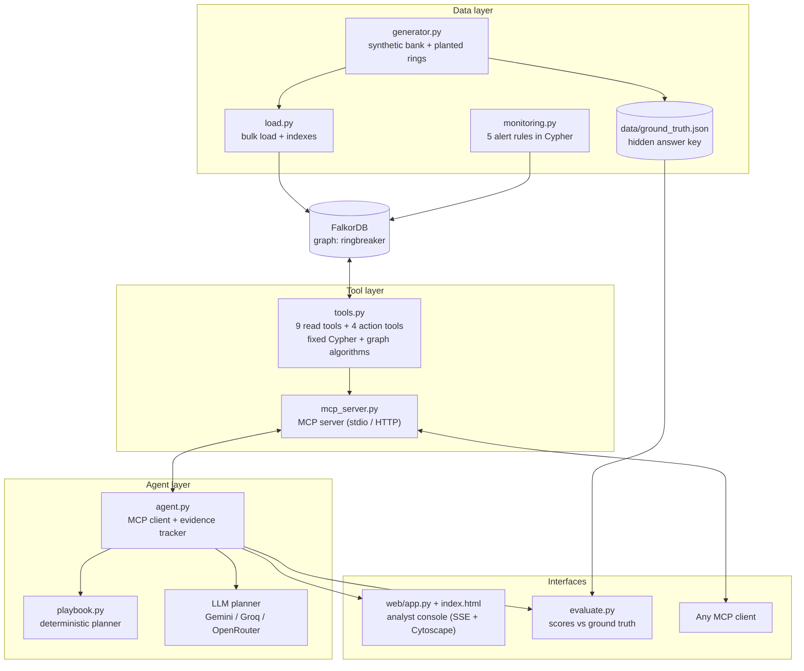
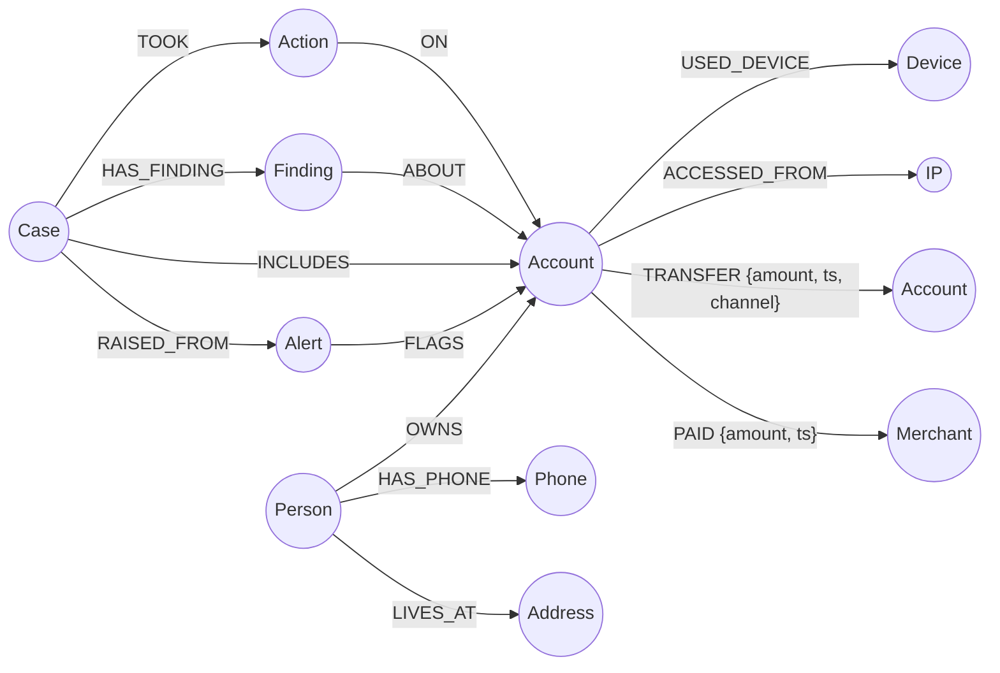
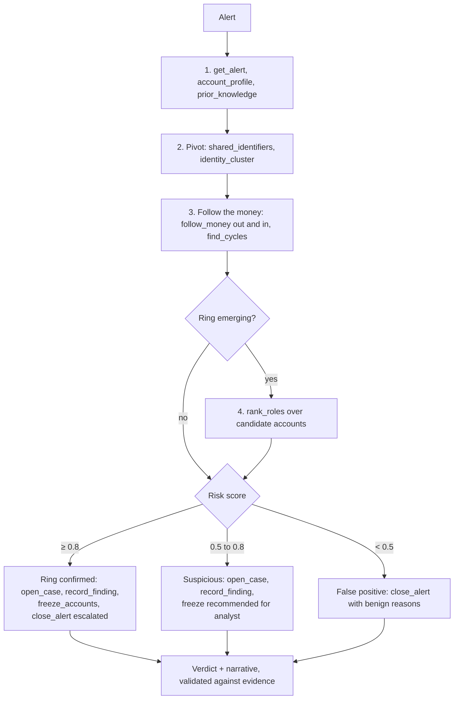

# RingBreaker: Architecture and Design

This document explains what RingBreaker is, why it is built on a graph database, how every part of the system works, and how the parts fit together. It is written so that someone new to fraud investigation, graph databases or agents can follow it from start to finish.

**Hackathon:** Graph Hacks by WeMakeDevs × FalkorDB
**Track:** 01, Agents That Act on Connected Data
**Repository:** https://github.com/Vivek-122005/ringbreaker

---

## Contents

1. [The problem](#1-the-problem)
2. [The idea in one paragraph](#2-the-idea-in-one-paragraph)
3. [Key concepts](#3-key-concepts)
4. [Why a graph database](#4-why-a-graph-database)
5. [System architecture](#5-system-architecture)
6. [The graph data model](#6-the-graph-data-model)
7. [Stage 1: the synthetic bank](#7-stage-1-the-synthetic-bank)
8. [Stage 2: loading FalkorDB](#8-stage-2-loading-falkordb)
9. [Stage 3: alert rules](#9-stage-3-alert-rules)
10. [Stage 4: the tool catalogue](#10-stage-4-the-tool-catalogue)
11. [Stage 5: the MCP server](#11-stage-5-the-mcp-server)
12. [Stage 6: the investigator agent](#12-stage-6-the-investigator-agent)
13. [Stage 7: acting on the graph](#13-stage-7-acting-on-the-graph)
14. [Stage 8: the analyst console](#14-stage-8-the-analyst-console)
15. [Stage 9: evaluation](#15-stage-9-evaluation)
16. [Walkthrough of one investigation](#16-walkthrough-of-one-investigation)
17. [Safety and trust design](#17-safety-and-trust-design)
18. [Tech stack](#18-tech-stack)
19. [Configuration](#19-configuration)
20. [Running the project](#20-running-the-project)
21. [How it maps to Track 01](#21-how-it-maps-to-track-01)
22. [Demo script](#22-demo-script)
23. [Limitations and next steps](#23-limitations-and-next-steps)
24. [Glossary](#24-glossary)

---

## 1. The problem

Banks are legally required to watch for money laundering and fraud. Almost all of them do it with **transaction monitoring rules**: simple checks such as "this account received money from 8 or more different people" or "this account sent out most of what it received within 24 hours". When a rule fires, it creates an **alert**, and a human analyst has to investigate it.

Two things make this expensive and ineffective:

- **Most alerts are false positives.** Industry reports put the figure above 90%. A family sharing a home Wi-Fi router, a company paying salaries, or a landlord collecting rent can all trip the same rules as a criminal.
- **Criminals work as networks, but rules look at one account at a time.** A single mule account looks only slightly odd. Ten mule accounts that share one phone emulator, sit on the same VPN address and pass the same money along within hours are obviously a ring, but no single-account rule can see that.

So analysts spend hours per alert pulling statements by hand, and real rings still get through.

The three criminal patterns ("typologies") RingBreaker targets are taken from public FATF and FinCEN guidance:

| Typology | What happens | What gives it away |
| --- | --- | --- |
| **APP-scam money-mule network** | Scam victims are tricked into an authorised push payment to a *collector* account. The collector splits the money across *layering* mules, and a *cash-out* account buys crypto or gift cards. | Many unrelated payers into one new account, fast pass-through, mules sharing devices/VPN IPs, money ending at high-risk merchants. |
| **Round-tripping** | Shell companies send the same money around a loop to fake business turnover. | A cycle of transfers that returns ~95%+ of the value to where it started; companies at one address. |
| **Synthetic-identity bust-out** | Fake customers built from shared phones, addresses and one PC age their accounts, then all drain them on the same day into a sink. | A cluster of "different" people sharing identity elements, accounts opened within days of each other, same-day drains. |

## 2. The idea in one paragraph

RingBreaker loads a bank's customers, accounts, devices, IPs, phones, addresses, merchants and transfers into a **FalkorDB graph**. The bank's existing rules raise alerts as usual. For each alert an **investigator agent** works the case the way a senior analyst would: it profiles the account, pivots on shared identity elements, follows the money in time order, looks for loops, finds the community the account belongs to, and ranks roles inside a suspected ring. It does this only through a fixed catalogue of reviewed graph queries served over **MCP**. Then it **acts**: it opens a case, records findings, freezes accounts (only when policy allows), or closes the alert as a false positive with a written reason. Every claim it makes must point to nodes and edges the graph actually returned, and everything it does is written back into the graph, so later investigations remember earlier ones.

## 3. Key concepts

If any of these terms are new, read this section first.

- **Graph database.** Stores data as *nodes* (things, such as a person or an account) and *relationships* (connections, such as "owns" or "transferred money to"). Queries walk along connections directly instead of joining tables.
- **FalkorDB.** A fast graph database that runs on Redis and speaks **Cypher**, the standard graph query language. It also ships built-in graph algorithms (WCC, PageRank, betweenness, shortest paths).
- **Cypher.** A query language where you draw the pattern you want: `(a:Account)-[:TRANSFER]->(b:Account)` means "an account that transferred to another account".
- **Agent.** A program that decides for itself which steps to take to reach a goal, using *tools*, and then takes real actions. Here the goal is "resolve this alert".
- **Planner.** The part of the agent that chooses the next tool. RingBreaker has two: a deterministic **playbook** and an optional **LLM** planner.
- **MCP (Model Context Protocol).** An open standard for exposing tools to agents. A *server* publishes a list of tools with typed inputs; any *client* can discover and call them.
- **WCC (Weakly Connected Components).** Splits a graph into groups where everything in a group is connected somehow. Used to find identity clusters.
- **PageRank.** Scores how "central" a node is by how much flow points at it. Used to find collectors.
- **Betweenness centrality.** Scores how often a node sits on the shortest path between others. Used to find layering mules that act as bridges.
- **Pass-through ratio.** Money sent out divided by money received. Close to 1.0 means the account is a conduit, not a real user.

## 4. Why a graph database

Every signal that separates a ring from a false positive is a **relationship**, not a column:

| Question an analyst asks | In a graph | In SQL tables |
| --- | --- | --- |
| Who else used this device? | One hop: `(a)-[:USED_DEVICE]->(d)<-[:USED_DEVICE]-(b)` | Self-join on a device table |
| Where did this money go, hop by hop, in time order? | One variable-length path pattern with a time filter | Recursive CTE that gets slow and hard to read fast |
| Does money come back to where it started? | `(a)-[:TRANSFER*2..6]->(a)` | Very awkward recursion with cycle detection |
| Which accounts form one identity cluster? | `algo.WCC` built in | Not practical in plain SQL |
| Who is the hub and who is the bridge? | `algo.pageRank`, `algo.betweenness` built in | Export to another tool |
| How are these two accounts connected at all? | `algo.SPpaths` built in | Not practical |

Two design choices make this work well:

1. **Identity elements are nodes, not properties.** A phone number is a `Phone` node, so "who else has this phone?" is a single hop instead of a string match.
2. **Every transfer is its own timestamped edge.** That lets a money trace insist that each hop happened after the previous one, which removes coincidental paths.

There is also a third, less obvious reason. The agent's own work (cases, findings, actions) is stored **in the same graph**. A finding is connected to the accounts it is about, so the next investigation that touches one of those accounts discovers it with an ordinary query. The graph is the agent's long-term memory.

## 5. System architecture



The system has four layers. Each depends only on the layer below it.

| Layer | Files | Responsibility |
| --- | --- | --- |
| Data | `generator.py`, `load.py`, `monitoring.py`, `db.py` | Create the bank, put it in FalkorDB, raise alerts |
| Tools | `tools.py`, `mcp_server.py` | The only code that talks to the graph during an investigation |
| Agent | `agent.py`, `playbook.py` | Decide which tools to call, score risk, decide and act |
| Interfaces | `web/`, `evaluate.py` | Show investigations live; measure accuracy |

### End-to-end data flow

```mermaid
sequenceDiagram
    participant U as Analyst (browser)
    participant W as FastAPI console
    participant A as Agent
    participant M as MCP server
    participant G as FalkorDB

    U->>W: Click alert, press Investigate
    W->>A: investigate(alert_id)
    A->>M: start over stdio, list_tools
    M-->>A: 13 tool definitions
    loop Each investigation step
        A->>M: call_tool(name, args)
        M->>G: fixed Cypher / algorithm
        G-->>M: rows
        M-->>A: data + evidence (nodes, edges)
        A-->>W: step / tool / result event
        W-->>U: SSE event; graph grows on screen
    end
    A->>M: open_case / record_finding / freeze_accounts / close_alert
    M->>G: write case, findings, actions
    A-->>W: verdict (validated against evidence)
    W-->>U: case report + evidence graph
```

## 6. The graph data model



### Nodes

| Label | Key properties | Why it exists |
| --- | --- | --- |
| `Person` | name, segment, kyc_date | The customer. Surnames help tell households from unrelated strangers. |
| `Account` | type, opened, status (active / frozen), balance | Where money sits and moves. |
| `Device` | os | A device fingerprint. One operator running many mules shows up as one device (often an emulator). |
| `IP` | asn, kind (residential / mobile / vpn / hosting) | Network origin. VPN and hosting IPs shared by strangers are a strong signal. |
| `Phone` | number | Identity element. |
| `Address` | line, city | Identity element. Separates a real household from a mail drop. |
| `Merchant` | name, category, risk | Where money leaves the bank. Crypto, gift cards and remittance are cash-out channels. |
| `Alert` | rule, detail, status, disposition | Output of the rules. This is the agent's input. |
| `Case` | typology, risk, summary, status | Written by the agent for a suspected or confirmed ring. |
| `Finding` | text, created | A piece of evidence the agent recorded. Long-term memory. |
| `Action` | kind, status, reason | Audit trail: what the agent did and why. |

### Relationships

| Pattern | Properties | Notes |
| --- | --- | --- |
| `(Person)-[:OWNS]->(Account)` | | |
| `(Person)-[:HAS_PHONE]->(Phone)` | | |
| `(Person)-[:LIVES_AT]->(Address)` | | |
| `(Account)-[:USED_DEVICE]->(Device)` | | |
| `(Account)-[:ACCESSED_FROM]->(IP)` | | |
| `(Account)-[:TRANSFER]->(Account)` | id, amount, ts, channel | One edge per payment, so time order can be enforced |
| `(Account)-[:PAID]->(Merchant)` | amount, ts | |
| `(Alert)-[:FLAGS]->(Account)` | | Written by the rules |
| `(Case)-[:RAISED_FROM]->(Alert)` | | Written by the agent |
| `(Case)-[:INCLUDES]->(Account)` | | Ring membership |
| `(Case)-[:HAS_FINDING]->(Finding)-[:ABOUT]->(any)` | | Evidence linked to the exact entities |
| `(Case)-[:TOOK]->(Action)-[:ON]->(Account)` | | Freeze or freeze recommendation |

Every node has an `id` property, and `load.py` creates an index on `id` for each label, so every lookup the tools do starts from an indexed node.

## 7. Stage 1: the synthetic bank

**File:** `ringbreaker/generator.py`

Real bank data is confidential, so RingBreaker generates a realistic bank from a fixed random seed. The same seed always produces the same bank, which makes results reproducible.

What it creates (default seed 7, 2,400 people, 90 days):

- **Normal population.** Customers with phones, addresses, one or more accounts, their own devices and home or mobile IPs, salary inflows, everyday transfers and merchant payments.
- **Planted criminal rings.**
  - 4 × APP-scam mule networks: victims → collector → structured layering (sub-10,000 splits) → cash-out → crypto merchant. Mules share emulator devices and a VPN IP.
  - 2 × round-tripping loops between shell companies registered at one address.
  - 2 × synthetic-identity bust-outs: fake people sharing phones and addresses, one PC, accounts opened close together, same-day drains to a sink.
- **Benign look-alikes** designed to trip the same rules:
  - 6 families sharing a home router and tablet (trips SHARED_DEVICE).
  - 4 payroll fan-outs (big money out to many people).
  - 3 landlords collecting rent from many tenants (trips FAN_IN).

The **answer key** (which accounts belong to which ring, and which look-alikes are benign) is written to `data/ground_truth.json`. Only the evaluation script reads it; the agent never sees it.

## 8. Stage 2: loading FalkorDB

**Files:** `ringbreaker/load.py`, `ringbreaker/db.py`

`db.py` is the single connection point:

- If `FALKORDB_HOST` is set, it connects to that FalkorDB server (local Docker or FalkorDB Cloud), using `FALKORDB_PORT`, `FALKORDB_USERNAME` and `FALKORDB_PASSWORD` when given.
- If not, it falls back to embedded FalkorDB (`falkordblite`) in a local file, which is handy for development without Docker.
- `read()` uses `ro_query` (read-only), and `write()` uses `query`. Read tools can therefore never modify the graph by accident.

`load.py` then:

1. Deletes the old graph so every run starts clean.
2. Creates an index on `id` for every label.
3. Bulk-inserts nodes with `UNWIND $rows AS r CREATE (n:Label) SET n = r` in batches of 2,000.
4. Bulk-inserts relationships the same way, matching endpoints by indexed id.
5. Saves the ground truth file.
6. Runs the alert rules (Stage 3).

On seed 7 this loads **17,322 nodes and 38,826 edges and raises 127 alerts in under a second** against FalkorDB in Docker.

## 9. Stage 3: alert rules

**File:** `ringbreaker/monitoring.py`

This module plays the role of the bank's existing rule engine. Each rule is a Cypher query that looks at one account at a time, exactly like real rule engines. They are deliberately noisy.

| Rule | Fires when |
| --- | --- |
| RAPID_MOVEMENT | ≥ 20,000 received and ≥ 80% sent out again within 24 hours |
| STRUCTURING | ≥ 3 transfers between 9,000 and 9,999 (just under a reporting threshold) |
| FAN_IN | ≥ 8 distinct senders |
| SHARED_DEVICE | One device used by accounts of ≥ 3 different customers |
| HIGH_RISK_MERCHANT | More than 50,000 spent at crypto, gift-card or remittance merchants |

Each hit becomes an `Alert` node linked to the account with `FLAGS`. On seed 7: 127 alerts on 82 accounts, covering 56 of the 58 criminal accounts and 26 innocent ones. Separating those is the agent's job.

## 10. Stage 4: the tool catalogue

**File:** `ringbreaker/tools.py`

This is the heart of the "graph" part of the project. Every tool is a plain Python function wrapping a **fixed, reviewed Cypher query or graph algorithm**. The agent can choose *which* tool to call and with *which* ids, but it can never write its own query.

Every tool:

- **Resolves ids first.** An unknown id raises a clear error instead of silently returning nothing.
- **Uses read-only queries** for reads.
- **Returns `data` and `evidence`.** `evidence` lists the node ids and edges that prove the result. The UI draws them, and the verdict validator checks against them.

### Read tools

| Tool | What it answers | Graph technique |
| --- | --- | --- |
| `get_alert` | What fired, on which account, and what else is open on it | 1-hop match |
| `account_profile` | Owner, tenure, account age, balance, total in/out, pass-through ratio, merchants | Aggregation over `TRANSFER` and `PAID` |
| `prior_knowledge` | Is anything here already in a case, finding or freeze? | Match over `Case`, `Finding`, `Action` |
| `shared_identifiers` | Who else uses this account's devices, IPs, phones, addresses? | 2-hop pivots through identity nodes |
| `identity_cluster` | Which accounts are tied together by identity elements, and how fast were they opened? | `algo.WCC` |
| `follow_money` | Where did the money go (or come from), hop by hop, in time order? | Variable-length `TRANSFER` paths with a time window |
| `find_cycles` | Does money loop back to this account, and how much survives the loop? | `(a)-[:TRANSFER*2..6]->(a)` |
| `rank_roles` | Inside a suspected ring, who is collector, layering, cash-out or sink? | `algo.pageRank` + `algo.betweenness` + in-ring flows |
| `explain_connection` | How are these two entities connected at all? | `algo.SPpaths`, either direction, ≤ 6 hops |

### Action tools

| Tool | What it does | Guard rail |
| --- | --- | --- |
| `open_case` | Creates a `Case`, links it to the alert and every ring account | Ids must exist |
| `record_finding` | Writes a `Finding` linked to the exact entities it is about | Ids must exist |
| `freeze_accounts` | Sets `status = 'frozen'` and logs an `Action` | **Only if case risk ≥ 0.8.** Otherwise it logs a *freeze recommendation* for a human. |
| `close_alert` | Closes the alert as `false_positive` or `escalated_to_case` with a reason | Only those two dispositions are accepted |

### Key queries

Time-ordered money trace (`follow_money`). Each hop must happen after the previous one and within the window, which filters out coincidental paths:

```cypher
MATCH p = (a:Account {id: $id})-[:TRANSFER*1..3]->(x:Account)
WITH p, relationships(p) AS r
WHERE all(e IN r WHERE e.amount >= $min)
  AND all(i IN range(0, size(r) - 2)
          WHERE r[i+1].ts >= r[i].ts AND r[i+1].ts - r[i].ts <= $window)
RETURN [n IN nodes(p) | n.id] AS path,
       [e IN r | {from: startNode(e).id, to: endNode(e).id, amount: e.amount, ts: e.ts}] AS hops
```

Shared device pivot (one branch of `shared_identifiers`):

```cypher
MATCH (a:Account {id: $id})-[:USED_DEVICE]->(x:Device)<-[:USED_DEVICE]-(b:Account)
RETURN 'Device' AS kind, x.id AS identifier, x.os AS info, b
```

Identity communities (`identity_cluster`):

```cypher
CALL algo.WCC({nodeLabels: ['Account','Person','Device','Phone','Address'],
               relationshipTypes: ['OWNS','USED_DEVICE','HAS_PHONE','LIVES_AT']})
YIELD node, componentId
```

Money loops (`find_cycles`):

```cypher
MATCH p = (a:Account {id: $id})-[:TRANSFER*2..6]->(a)
RETURN [e IN relationships(p) | {from: startNode(e).id, to: endNode(e).id, amount: e.amount, ts: e.ts}] AS hops
```

Role ranking (`rank_roles`):

```cypher
CALL algo.pageRank('Account', 'TRANSFER') YIELD node, score
CALL algo.betweenness({nodeLabels: ['Account'], relationshipTypes: ['TRANSFER']}) YIELD node, score
```

How roles are assigned in `rank_roles`:

| Role | Rule |
| --- | --- |
| collector | ≥ 3 senders from outside the ring and sends money onward |
| cash_out | Receives ring money and spends at high-risk merchants |
| layering | Receives and sends inside the ring |
| source | Only sends inside the ring |
| sink | Only receives inside the ring |

## 11. Stage 5: the MCP server

**File:** `ringbreaker/mcp_server.py`

The tool catalogue is published as an **MCP server** using the official `mcp` Python SDK (`FastMCP`). Each function in `tools.py` becomes an MCP tool, and its docstring becomes the description the planner reads.

Why put an MCP server in between instead of calling the functions directly?

- **One fixed surface.** Every client, whether the RingBreaker agent, an IDE or a desktop app, gets the same 13 reviewed tools and nothing else. There is no "run arbitrary Cypher" tool.
- **Tool discovery.** The agent does not hard-code the tool list. It asks the server at runtime, so adding a tool to `tools.py` makes it available everywhere.
- **Reuse.** Other teams' agents could investigate the same graph through the same tools.

Two transports:

```bash
python -m ringbreaker.mcp_server          # stdio (what the RingBreaker agent uses)
python -m ringbreaker.mcp_server --http   # streamable HTTP on port 8765
```

Errors raised by a tool are returned as `{"error": "..."}` so the planner can read them and recover instead of crashing.

## 12. Stage 6: the investigator agent

**Files:** `ringbreaker/agent.py`, `ringbreaker/playbook.py`

`agent.py` starts the MCP server as a subprocess, connects as an MCP client, lists the tools and hands them to a planner. It produces a stream of events (`step`, `tool`, `result`, `thought`, `validation`, `verdict`, `error`) that the console and the evaluator consume.

### The analyst procedure

Both planners follow the same procedure a senior financial-crime analyst would:



### Planner 1: the playbook (default)

`playbook.py` encodes the procedure as deterministic code with a **transparent additive risk score**. Each signal adds or subtracts a fixed weight and is recorded as a piece of evidence with the entities that prove it. That makes every decision explainable line by line.

| Signal | Weight |
| --- | --- |
| Pass-through account (≥ 80% out, ≥ 20,000 in), new account | +0.20 (+0.05 if older than 120 days) |
| Long-standing customer (> 1 year) | −0.15 |
| Already linked to an earlier case or finding | +0.30 |
| VPN / hosting IP or emulator shared with unrelated customers | +0.25 |
| Device shared with ≥ 2 unrelated customers | +0.20 |
| Phone or address shared with people of different surnames | +0.15 |
| Identifiers shared only within one household | −0.10 |
| WCC cluster ≥ 4 accounts, ≥ 3 surnames, opened within 30 days | +0.20 |
| Structuring: repeated sub-10,000 splits to ≥ 2 accounts | +0.15 |
| Money moved within hours through ≥ 3 identity-linked accounts | +0.15 |
| ≥ 5 different payers into a new account (possible scam victims) | +0.15 |
| Loop returning ≥ 90% of value | +0.60 |
| Ring money leaving through crypto / gift-card / remittance merchants | +0.20 |

The playbook also works out the **typology**: a loop means round-tripping; a collector role means an APP-scam mule network; an identity cluster or shared phones means a synthetic-identity bust-out.

The "different surnames" checks are what separate a family sharing a router (benign) from strangers sharing a VPN (criminal), even though both trip the same SHARED_DEVICE rule.

### Planner 2: the LLM (optional)

If a key is configured (`GEMINI_API_KEY`, `GROQ_API_KEY` or `OPENROUTER_API_KEY`), the LLM planner takes over. It uses function calling through any OpenAI-compatible endpoint:

- The system prompt describes the same analyst procedure, the benign and suspicious signals, and the rules (never invent ids; an empty result means no link, not innocence).
- The tool definitions come straight from the MCP server, plus one extra function, `submit_verdict`, with a strict schema (outcome, typology, risk, ring accounts, evidence with entity ids, narrative).
- It is capped at **18 tool calls**. When the budget runs out, it is told to act and submit.
- Temperature is 0.1 for consistent behaviour.

The playbook is the measured baseline, so the LLM planner can be compared against it with the same evaluation.

### The evidence tracker

`Tracker` in `agent.py` collects every node id and edge that any tool returned during the investigation. When a verdict is submitted, `Tracker.check()` lists every cited id that never appeared in a tool result.

- **LLM planner:** a verdict citing unseen ids is **rejected** and sent back with the list of bad ids, so the planner has to correct it. On the final attempt, the bad ids are stripped.
- **Playbook:** the same check runs, and `unverified_ids_removed` is reported in the verdict.

This is what "explainable" means here: every account in a verdict is backed by a path in the graph that a tool actually returned.

## 13. Stage 7: acting on the graph

Track 01 asks for agents that **act**, not just answer. RingBreaker's actions are real writes to the graph:

| Outcome | Actions taken |
| --- | --- |
| Ring confirmed (risk ≥ 0.8) | `open_case` with every ring account → up to 4 × `record_finding` → `freeze_accounts` on collector, layering, cash-out and sink accounts → `close_alert` as `escalated_to_case` |
| Suspicious (0.5 to 0.8) | Same, but `freeze_accounts` records a **freeze recommendation** (`pending_analyst`) instead of freezing |
| False positive (< 0.5) | `close_alert` as `false_positive` with the benign reasons written down |

Because these writes live in the graph:

- **Memory.** `prior_knowledge` finds earlier cases and findings on any entity, and that adds +0.30 to the risk score.
- **Audit.** Every freeze is an `Action` node with a reason, linked to the case and the accounts.
- **De-duplication.** The evaluator (like a real analyst) closes other alerts on accounts already in a case, so the same ring is not investigated twice.

## 14. Stage 8: the analyst console

**Files:** `ringbreaker/web/app.py`, `ringbreaker/web/static/index.html`

A FastAPI app with a single-page frontend (plain HTML/JS, with Cytoscape.js vendored locally, so there is no build step).

| Endpoint | Purpose |
| --- | --- |
| `GET /` | The console page |
| `GET /api/status` | Active planner, alert / open / case / frozen counts, node count |
| `GET /api/alerts` | Alert queue with owner and account status |
| `GET /api/cases` | Cases the agent has opened |
| `GET /api/investigate/{alert_id}?planner=auto\|llm\|playbook` | Runs an investigation and streams events with **Server-Sent Events** |
| `POST /api/reset` | Rebuilds the demo bank (clears cases and freezes) |

What the analyst sees:

1. The **alert queue** on one side.
2. Pressing *Investigate* opens an SSE stream. Each tool call and result appears live in a step log.
3. The **evidence graph** grows as tools return new nodes. The server sends only nodes the browser has not seen yet, each with its label and caption.
4. The **verdict panel** shows outcome, typology, risk, ring members, roles, the evidence list and the narrative (a draft for a suspicious activity report).

An `asyncio.Lock` makes sure only one investigation writes to the graph at a time.

## 15. Stage 9: evaluation

**File:** `ringbreaker/evaluate.py`

```bash
python -m ringbreaker.evaluate              # playbook, every open alert
python -m ringbreaker.evaluate --planner llm --limit 20
python -m ringbreaker.evaluate --seed 42
```

The evaluator rebuilds the bank, investigates every open alert, and compares each verdict with the hidden ground truth:

- **True positive:** a criminal account escalated.
- **False positive:** an innocent account escalated ("innocent escalated").
- **True negative:** an innocent account cleared ("false positives cleared").
- **False negative:** a criminal account cleared ("missed").
- **Ring recall:** the share of the true ring's accounts found from that one alert.
- **Typology accuracy:** whether the ring type was labelled correctly.
- **Frozen innocents:** innocent accounts that ended up frozen.

Results with the playbook planner:

| Seed | Alerts | Rings caught | Missed | FPs cleared | Innocent escalated | Frozen (innocent) |
| --- | --- | --- | --- | --- | --- | --- |
| 7 | 127 | 8 of 8 | 0 | 26 | 0 | 45 (0) |
| 11 | 117 | 8 of 8 | 0 | 28 | 0 | 43 (0) |
| 23 | 128 | 8 of 8 | 0 | 27 | 0 | 47 (0) |
| 42 | 125 | 8 of 8 | 0 | 26 | 0 | 47 (0) |

On every seed, precision and recall were 1.00, one alert uncovered 100% of its ring's accounts, and the typology was right 8 of 8 times. The seed 7 run was reproduced against FalkorDB in Docker in 19.4 seconds for 34 investigations.

These numbers show the method works on these typologies in synthetic data. They are not a claim about real bank data.

## 16. Walkthrough of one investigation

A typical mule-network alert, step by step (ids are illustrative):

1. **Alert.** `FAN_IN` fires on account `ACC-02474`: 11 distinct senders.
2. **Profile.** The account is 21 days old, received 148,000 and sent on 96% of it. +0.20.
3. **Prior knowledge.** Nothing known yet.
4. **Shared identifiers.** Its device is an Android emulator also used by 6 accounts owned by people with different surnames. Its IP is a VPN shared with them. +0.25 for the VPN, +0.20 for the device. These accounts join the candidate ring.
5. **Identity cluster.** WCC returns a cluster of 8 accounts with 7 surnames, all opened within 12 days. +0.20.
6. **Follow money out.** Within 72 hours, funds split into repeated 9,4xx transfers to 5 accounts (+0.15), which pass through accounts that share identity elements (+0.15).
7. **Follow money in.** 11 different customers paid this new account just before the money moved: possible scam victims. +0.15.
8. **Cycles.** None.
9. **Rank roles.** PageRank and betweenness over the candidate accounts label one collector, five layering mules and one cash-out account that spent 120,000 on crypto. +0.20.
10. **Score.** Capped at 1.0. Outcome: ring confirmed. Typology: APP-scam mule network.
11. **Act.** Open a case with all ring accounts, record 4 findings linked to the exact entities, freeze the collector, layering and cash-out accounts (policy allows it at risk ≥ 0.8), and close the alert as escalated.
12. **Verdict.** A narrative listing every claim, validated so that every cited account appeared in a tool result. The console shows the ring as a graph.

A benign alert ends very differently: a family's shared router and tablet trip SHARED_DEVICE, but the identifiers are shared only within one surname at one address (−0.10 each), the customers have years of tenure (−0.15), and there is no fast pass-through. The risk stays below 0.5, and the alert is closed as a false positive with those reasons written down.

## 17. Safety and trust design

| Risk | Mitigation |
| --- | --- |
| The agent writes a harmful or wrong query | It cannot. It only chooses among fixed, reviewed queries. No raw Cypher tool exists. |
| A read tool modifies data | Reads go through `ro_query`. |
| The agent hallucinates an account | Ids are resolved before every query. Verdicts citing unseen ids are rejected (LLM) or stripped. |
| The agent freezes an innocent customer | Freezing requires case risk ≥ 0.8. Below that it only records a recommendation for a human. Measured innocent freezes: 0 on all four seeds. |
| No record of why something happened | Every case, finding, freeze and closure is a node with a reason and a timestamp. |
| Runaway LLM loop | Hard cap of 18 tool calls, then forced submission. |
| Secrets leaking into the repo | Keys are read from the environment or a git-ignored `.env` file. |

## 18. Tech stack

| Component | Choice | Why |
| --- | --- | --- |
| Graph database | **FalkorDB** (Docker or Cloud) | Fast Cypher engine with built-in WCC, PageRank, betweenness and shortest paths; the hackathon's core technology |
| Dev fallback | falkordblite (embedded) | Run without Docker |
| Language | Python 3.11+ | Fast to build; official FalkorDB and MCP SDKs |
| Graph client | `falkordb` Python package | Official client |
| Tool protocol | **MCP** (`mcp` Python SDK, FastMCP) | Standard, discoverable, reusable tool surface |
| LLM access | `httpx` to OpenAI-compatible endpoints | Works with Gemini, Groq and OpenRouter without extra SDKs |
| Web server | FastAPI + Uvicorn | Async, simple SSE streaming |
| Frontend | Plain HTML/JS + Cytoscape.js (vendored) | Interactive graph drawing with no build step |
| Data | Seeded synthetic generator | Reproducible, no confidential data |

## 19. Configuration

Settings come from environment variables. They can also be put in a `.env` file in the project root, which is git-ignored and loaded automatically at import time (existing environment variables win).

| Variable | Default | Meaning |
| --- | --- | --- |
| `FALKORDB_HOST` | unset | FalkorDB host. Unset means embedded falkordblite. |
| `FALKORDB_PORT` | 6379 | Port |
| `FALKORDB_USERNAME`, `FALKORDB_PASSWORD` | unset | For FalkorDB Cloud |
| `RB_GRAPH` | ringbreaker | Graph name |
| `FALKORDB_LITE_PATH` | data/ringbreaker.db | Embedded database file |
| `GEMINI_API_KEY` / `GROQ_API_KEY` / `OPENROUTER_API_KEY` | unset | Enables the LLM planner |
| `RB_LLM_PROVIDER` | first with a key | `gemini`, `groq` or `openrouter` |
| `RB_MODEL` | provider default | Override the model name |
| `RB_ALLOW_RESET` | 1 | Set to 0 to disable `/api/reset` |

Example `.env`:

```
FALKORDB_HOST=localhost
GEMINI_API_KEY=your-key-here
```

## 20. Running the project

```bash
docker run -d -p 6379:6379 -p 3000:3000 --name falkordb falkordb/falkordb
python3 -m venv .venv && source .venv/bin/activate
pip install -r requirements.txt
export FALKORDB_HOST=localhost

python -m ringbreaker.load                      # build the bank, load FalkorDB, raise alerts
uvicorn ringbreaker.web.app:app --port 8000     # analyst console at http://localhost:8000
python -m ringbreaker.evaluate                  # score against ground truth
```

The FalkorDB Browser at http://localhost:3000 can run every query in this document against the loaded graph.

### Project layout

```
ringbreaker/
  __init__.py     loads .env settings
  db.py           FalkorDB connection (server or embedded), read/write helpers
  generator.py    synthetic bank + planted typologies + ground truth
  load.py         loads the graph, creates indexes, runs the alert rules
  monitoring.py   alert rules (Cypher)
  tools.py        investigation tool catalogue (Cypher + algorithms)
  mcp_server.py   MCP server exposing the tools
  agent.py        MCP client, LLM planner, evidence tracker
  playbook.py     deterministic planner and risk score
  evaluate.py     scoring against ground truth
  web/
    app.py        FastAPI console + SSE
    static/       index.html, vendored cytoscape.min.js
docs/
  ARCHITECTURE.md this document
```

## 21. How it maps to Track 01

Track 01 is "Agents That Act on Connected Data".

| Track expectation | Where RingBreaker delivers it |
| --- | --- |
| **Agents** | A tool-using investigator that plans multi-step investigations (playbook or LLM planner) over tools it discovers at runtime |
| **Act** | Opens cases, records findings, freezes accounts under a policy gate, closes alerts, all as real graph writes |
| **Connected data** | Every decisive signal is a relationship: shared devices, time-ordered money paths, loops, communities, centrality |
| **FalkorDB-native** | Cypher path patterns, `algo.WCC`, `algo.pageRank`, `algo.betweenness`, `algo.SPpaths`, indexes, read-only queries |
| **Explainability** | Evidence on every tool result; verdicts validated against it; the UI draws the proving subgraph |
| **Memory** | Cases and findings live in the graph and feed `prior_knowledge` |
| **Measured results** | Hidden ground truth; 8 of 8 rings, 0 innocents escalated or frozen across four seeds |
| **Interoperability** | The tool catalogue is an MCP server any MCP client can use |

## 22. Demo script

A 3-minute demo:

1. **The problem (30 s).** "Banks drown in alerts, 90% false positives, while criminals work as networks that single-account rules cannot see." Show the alert queue: 127 alerts.
2. **A false positive (40 s).** Investigate a SHARED_DEVICE alert on a family. The graph shows one household, one surname and long tenure. The agent closes it as a false positive and writes down why.
3. **A mule ring (60 s).** Investigate a FAN_IN alert. Watch the graph grow live: shared emulator → VPN IP → WCC cluster → time-ordered money trail → crypto cash-out. Roles appear (collector, layering, cash-out). The agent opens a case, records findings and freezes the accounts.
4. **Memory (20 s).** Investigate another alert on a ring member. `prior_knowledge` finds the existing case immediately.
5. **Trust (20 s).** Point out that tools are fixed Cypher served over MCP, verdicts can cite only graph evidence, and freezes are policy-gated.
6. **Results (10 s).** Run or show the evaluation: 8 of 8 rings, 0 innocent escalated, 100% of false positives cleared.

## 23. Limitations and next steps

- **Synthetic data.** The typologies are modelled on public guidance, but real data is messier. The next step is testing on a public anonymised dataset (for example, the IBM AML transactions dataset).
- **Fixed weights.** The playbook's weights were chosen by hand. They could be learned from analyst decisions stored as graph feedback.
- **Batch alerts.** Alerts are raised in one pass. A streaming version would run rules and investigations as transfers arrive.
- **Single investigator.** Investigations run one at a time because they write to the graph. Read phases could run in parallel.
- **Human in the loop.** The console could let an analyst approve or reject a freeze recommendation, recording that decision in the graph.

## 24. Glossary

| Term | Meaning |
| --- | --- |
| AML | Anti-money laundering |
| APP scam | Authorised push payment scam: the victim is tricked into sending the money themselves |
| Bust-out | Building credit with fake identities, then draining everything at once |
| Cash-out | The point where criminal money leaves the banking system (crypto, gift cards, remittance) |
| Collector | First mule account that receives victims' money |
| FATF / FinCEN | International and US bodies that publish money-laundering typologies |
| Layering | Moving money through many accounts to hide its origin |
| Mule | An account (often recruited or fake) used to move criminal money |
| Round-tripping | Sending money in a loop to fake business activity |
| SAR | Suspicious activity report filed with regulators |
| Structuring | Splitting amounts to stay just under a reporting threshold |
| Typology | A known pattern of financial crime |
