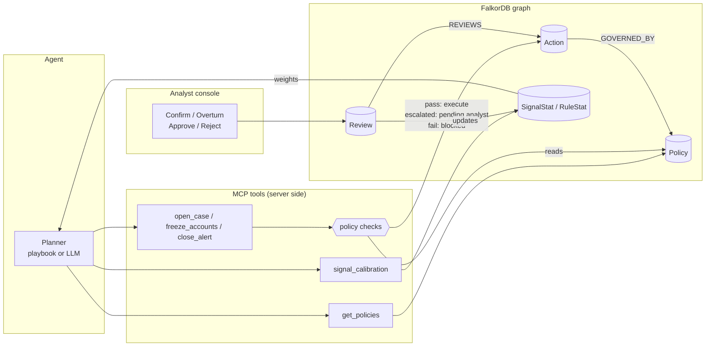
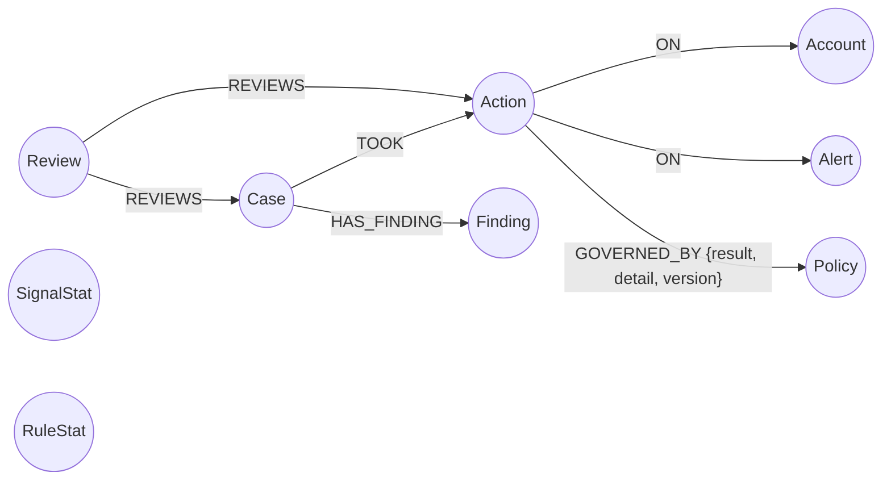
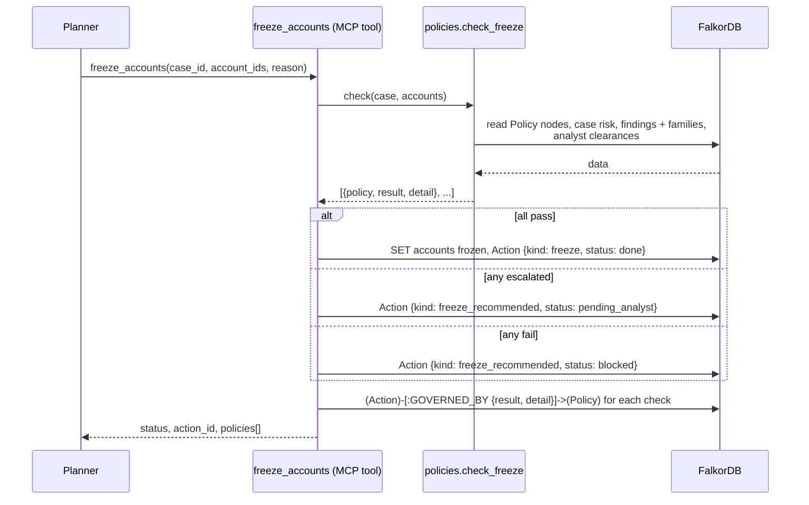

# Policies and Analyst Feedback

This document describes two features on the `feature/feedback-and-policies` branch:

- **Policies and must-follow rules.** The bank's rules for what the agent may do are stored in the graph and enforced inside the action tools, so no planner (playbook or LLM) can bypass them.
- **Feedback and learning.** Analysts confirm or overturn cases and approve or reject freezes. Their decisions are stored in the graph, can reverse what the agent did, and calibrate the agent's evidence weights within fixed limits.

The main branch and the live site are not affected until this branch is merged. The last section explains what merging would change.

---

## Contents

1. [Why these features](#1-why-these-features)
2. [What changes, in one picture](#2-what-changes-in-one-picture)
3. [Graph model additions](#3-graph-model-additions)
4. [The policies](#4-the-policies)
5. [How an action is checked](#5-how-an-action-is-checked)
6. [How an analyst review works](#6-how-an-analyst-review-works)
7. [How the agent learns from reviews](#7-how-the-agent-learns-from-reviews)
8. [New tools and API endpoints](#8-new-tools-and-api-endpoints)
9. [Key Cypher queries](#9-key-cypher-queries)
10. [Console changes](#10-console-changes)
11. [Tests and evaluation results](#11-tests-and-evaluation-results)
12. [Limitations and open questions](#12-limitations-and-open-questions)
13. [What merging to main would change](#13-what-merging-to-main-would-change)
14. [Sources](#14-sources)

---

## 1. Why these features

Before this branch, the agent's guard rails were a single hard-coded threshold: a freeze ran only when case risk was 0.8 or higher. Nothing recorded *which* rule allowed an action, a human could not undo or approve anything, and what analysts concluded had no effect on later investigations.

Real financial-crime operations work differently, and the design follows four widely documented practices:

| Practice | What it means here | Source |
| --- | --- | --- |
| **Risk-based approach.** Controls are proportionate to risk; stronger measures need stronger justification. | Freezes, the most harmful action, need high risk, corroborated evidence and, in some situations, a human. Low-impact actions (recording a finding) need nothing extra. | FATF, *Risk-Based Approach for the Banking Sector* (2014) [1] |
| **Human oversight of automated decisions.** People must be able to understand the system's output, notice over-reliance on it ("automation bias"), and override, reverse or stop it. | Analysts can approve, reject, confirm or overturn every consequential decision, and the agent may not silently undo their decisions (policy POL-RESPECT-ANALYST). | EU AI Act, Article 14(4) [2] |
| **Documented reasoning.** Reports to regulators must explain who, what, when, where and why (and how). | Every action records the policies it was checked against, with a plain-language detail line; false-positive closures must cite a graph fact. | FinCEN SAR narrative guidance [3] |
| **Model monitoring and outcomes analysis.** Models are monitored in use and compared against actual outcomes; overrides are a monitoring signal. | Each evidence signal and each monitoring rule keeps a confirmed/overturned tally from analyst reviews. Signal weights move with that tally, within bounds, and rule precision is reported. | Federal Reserve / OCC SR 11-7 model risk guidance (2011) [4], see the caveat in [Sources](#14-sources) |

What this adds to the hackathon story: the agent does not only *act* on connected data, it acts **within rules that live in the same graph**, and it **improves from human decisions** without ever becoming a black box.

## 2. What changes, in one picture



Two rules shape the design:

1. **Policies are enforced where the write happens.** The planner can read the policies, but the checks run inside the tool on the server. An LLM that "decides" to freeze anyway still cannot: the tool refuses.
2. **Humans act through a different door.** Reviews go through the console's HTTP API, not through MCP. The agent has no tool to approve its own actions.

## 3. Graph model additions



### New nodes

| Label | Properties | Purpose |
| --- | --- | --- |
| `Policy` | id, name, applies_to, version, active, rationale, plus its parameters (for example `min_risk`, `min_findings`) | A must-follow rule. Parameters are data, so a compliance officer can change a threshold without a code change. |
| `Review` | id, decision (confirm / overturn / approve / reject), note, ts, reviewer | An analyst decision. Never deleted. |
| `SignalStat` | signal, confirmed, overturned | How often analysts agreed with cases that used this evidence signal. |
| `RuleStat` | rule, confirmed, overturned | How often analysts agreed with cases raised by this monitoring rule. |

### Changed nodes

| Label | Change |
| --- | --- |
| `Action` | Now created for every action tool call (`open_case`, `freeze` / `freeze_recommended`, `close_alert`, `verdict`, `unfreeze` effects), not only freezes. `status` is one of `done`, `pending_analyst`, `blocked`, `reversed`, `rejected`. Approved overrides carry `approved_by` and `override`. |
| `Case` | New `signals` list (the evidence signals behind its risk score) and a `status` that reviews move from `open` to `confirmed` or `overturned`. |
| `Finding` | New `family`: money_movement, shared_identity, network_structure, prior_knowledge or other. Given by the planner or inferred from the text. |

### New relationships

| Pattern | Properties |
| --- | --- |
| `(Action)-[:GOVERNED_BY]->(Policy)` | result (pass / escalated / fail), detail, version |
| `(Review)-[:REVIEWS]->(Case)` or `(Review)-[:REVIEWS]->(Action)` | |
| `(Action)-[:ON]->(Alert)` | for `close_alert` and `verdict` actions |

## 4. The policies

All seven policies are seeded by `load.py` from `ringbreaker/policies.py`. Results mean:

- **pass:** satisfied.
- **escalated:** not executed automatically; it waits for an analyst (status `pending_analyst`).
- **fail:** blocked (status `blocked`); an analyst may still approve it, which is recorded as an override.

An action executes only if every applicable policy passes. Any `fail` makes it `blocked`; otherwise any `escalated` makes it `pending_analyst`.

| Policy | Applies to | Rule | Why it exists |
| --- | --- | --- | --- |
| **POL-FREEZE-RISK** | freeze_accounts | pass if case risk ≥ 0.8; escalated if 0.5 to 0.8; fail below 0.5 | Proportionality: the most harmful action needs the highest confidence. Borderline cases go to a person. |
| **POL-FREEZE-EVIDENCE** | freeze_accounts | the case has ≥ 3 findings from ≥ 2 families (money movement, shared identity, network structure) | One noisy signal must never freeze a customer. Independent kinds of evidence must agree. |
| **POL-RESPECT-ANALYST** | freeze_accounts | escalated if any account was in an overturned case or under a freeze an analyst rejected | The agent must never silently undo a human decision. If it finds new evidence, it asks again. |
| **POL-HUMAN-REVIEW** | freeze_accounts | escalated if the freeze covers more than 15 accounts | Limits the blast radius of an automatic action. |
| **POL-CASE-CONNECTED** | open_case | every case account must be reachable from the alerted account within 4 hops over identity or money edges; others are left out of the case | A case may not sweep in unrelated customers. |
| **POL-FP-REASON** | close_alert (false_positive) | the reason has ≥ 20 characters and names at least one entity that exists in the graph | A closed alert must be auditable: the reason has to point at facts. |
| **POL-EVIDENCE-GROUNDED** | verdict | every id cited in the verdict appeared in a tool result | Formalises the existing evidence validator, and now records its result in the graph. |

**How the 4-hop limit was chosen.** It was measured on the seed 7 bank. At 4 hops, every account of all 8 criminal rings is reachable from the alerted account, while only 13 of 200 randomly chosen accounts are (6.5%). At 5 hops that rises to 43 of 200, so the check would stop meaning much.

| Hop limit | Ring accounts reachable | Random accounts reachable (of 200) |
| --- | --- | --- |
| 2 | 57 of 58 | 1 |
| 3 | 58 of 58 | 4 |
| 4 | 58 of 58 | 13 |
| 5 | 58 of 58 | 43 |

## 5. How an action is checked



The tool's reply lists every check, so the planner (and the UI) can explain what happened. The LLM's system prompt now starts with `get_policies`, asks for at least three findings from two families before a freeze, and tells it not to retry an action to get around a policy.

`close_alert` works the same way: a failing POL-FP-REASON leaves the alert open and replies "Alert NOT closed: fix the reason as the failed policy describes". `open_case` drops unconnected accounts and records that.

After the verdict, the agent writes a `verdict` action with the POL-EVIDENCE-GROUNDED result, so the audit trail covers the whole investigation.

## 6. How an analyst review works

```mermaid
sequenceDiagram
    participant AN as Analyst (console)
    participant API as FastAPI
    participant RV as review.py
    participant G as FalkorDB

    AN->>API: POST /api/cases/{id}/review {decision: overturn, note}
    API->>RV: review_case
    RV->>G: CREATE (Review)-[:REVIEWS]->(Case)
    RV->>G: SET case.status = overturned
    RV->>G: SignalStat / RuleStat overturned + 1
    RV->>G: freezes of the case -> reversed;<br/>accounts -> active unless another live freeze holds them
    API-->>AN: {status, unfrozen: [...]}
```

| Review | Target | Effect |
| --- | --- | --- |
| confirm | Case | status `confirmed`; every signal and the raising rule get confirmed + 1 |
| overturn | Case | status `overturned`; tallies get overturned + 1; executed freezes are `reversed` and their accounts unfrozen (unless another live freeze holds them); pending freezes are `rejected`; the alert's disposition becomes `overturned_by_analyst` |
| approve | Freeze action | a `pending_analyst` or `blocked` freeze is executed; `approved_by: analyst`, and `override: true` if it had been blocked |
| reject | Freeze action | an executed freeze is `reversed` and accounts unfrozen; a pending one is `rejected` |

Guard rails: a case can be reviewed once (a second review returns HTTP 400), a reversed or rejected freeze cannot be approved again, and every decision stays in the graph as a `Review` node.

What the agent sees afterwards:

- `prior_knowledge` now reports `known_bad` (entity in a case nobody overturned) and `analyst_cleared` (every case on it was overturned).
- The playbook adds **−0.30** for an analyst-cleared account (signal `analyst_cleared`) instead of +0.30 for a known one.
- If strong new evidence still points at the same accounts, POL-RESPECT-ANALYST holds the freeze for the analyst instead of executing it.

## 7. How the agent learns from reviews

The playbook's score is a sum of named evidence signals (for example `risky_infra_shared` = +0.25, `identity_cluster` = +0.20; the full list is in `learning.SIGNALS`). Each case stores which signals it used. Each review credits or debits those signals.

### The maths

For each risk-raising signal with `c` confirmed and `o` overturned reviews:

```
precision = (c + PSEUDO × PRIOR) / (c + o + PSEUDO)
factor    = clamp(precision / PRIOR, 0.5, 1.5)
weight    = base_weight × factor
```

with `PRIOR = 0.75` (assumed precision before any review) and `PSEUDO = 4` (that assumption counts as four reviews).

- **Smoothing.** With no reviews the factor is exactly 1, and one review moves a weight only a little. A signal needs consistent outcomes to change much.
- **Bounds.** The weight can never go below half or above one and a half times its reviewed base value. In practice the upper bound is 1/0.75 = 1.33×, because precision cannot exceed 1.
- **Scope.** Only positive (risk-raising) weights are calibrated. Benign signals keep their base weight, because false-positive closures are not reviewed on this branch.
- **Transparency.** The evidence list shows each moved weight, for example "weight 0.25 → 0.3 after 6 analyst reviews". `signal_calibration` and `GET /api/learning` return every weight with its counts.

### Worked example: `risky_infra_shared` (base +0.25)

| Reviews (confirmed / overturned) | precision | factor | weight |
| --- | --- | --- | --- |
| none | 0.75 | 1.000 | 0.250 |
| 1 / 0 | 0.80 | 1.067 | 0.267 |
| 6 / 0 | 0.90 | 1.200 | 0.300 |
| 20 / 0 | 0.96 | 1.278 | 0.319 |
| 0 / 1 | 0.60 | 0.800 | 0.200 |
| 3 / 3 | 0.60 | 0.800 | 0.200 |
| 0 / 6 | 0.30 | 0.500 (clamped from 0.4) | 0.125 |

Step by step for 6 confirmed, 0 overturned: precision = (6 + 4 × 0.75) / (6 + 0 + 4) = 9 / 10 = 0.90; factor = 0.90 / 0.75 = 1.2; weight = 0.25 × 1.2 = 0.30.

### Rule precision

Each review also updates `RuleStat` for the monitoring rule that raised the case's alert. `precision = confirmed / reviews` per rule is exposed through `signal_calibration` and `GET /api/learning`. It is the data an analytics dashboard needs to show which rules waste analyst time.

### Learning survives a demo reset

`load()` keeps `SignalStat` and `RuleStat` across a rebuild by default (`keep_learning=True`), so the console's Reset button does not erase what analysts taught. The evaluation always starts clean (`keep_learning=False`).

## 8. New tools and API endpoints

### MCP tools (read)

| Tool | Returns |
| --- | --- |
| `get_policies` | Every active policy with its parameters and rationale |
| `signal_calibration` | Each signal's base weight, current weight, factor and review counts; each rule's analyst precision; the method constants |

### MCP tools (changed)

| Tool | Change |
| --- | --- |
| `open_case` | New optional `signals`; enforces POL-CASE-CONNECTED; returns `account_ids`, `action` and `policies` |
| `record_finding` | New optional `family`; inferred from the text when omitted |
| `freeze_accounts` | Enforces the four freeze policies; returns `status`, `action_id` and `policies` |
| `close_alert` | Enforces POL-FP-REASON; returns `status`, `action_id`, `policies`; does not close when blocked |
| `prior_knowledge` | Returns `known_bad`, `analyst_cleared` and per-entity `analyst_confirmed` |

### HTTP API (console only, not MCP)

| Method and path | Body | Purpose |
| --- | --- | --- |
| `POST /api/cases/{id}/review` | `{"decision": "confirm" \| "overturn", "note": "..."}` | Review a case |
| `POST /api/actions/{id}/review` | `{"decision": "approve" \| "reject", "note": "..."}` | Review a freeze |
| `GET /api/policies` | | Active policies |
| `GET /api/learning` | | Signal calibration and rule precision |
| `GET /api/status` | | Now also returns `to_review` (open cases plus pending freezes) |

## 9. Key Cypher queries

Seeding policies as data:

```cypher
UNWIND $rows AS r MERGE (p:Policy {id: r.id}) SET p = r
```

Evidence behind a freeze (POL-FREEZE-RISK and POL-FREEZE-EVIDENCE):

```cypher
MATCH (c:Case {id: $id})
OPTIONAL MATCH (c)-[:HAS_FINDING]->(f:Finding)
RETURN c.risk AS risk, count(f) AS findings, collect(DISTINCT f.family) AS families
```

Accounts an analyst already cleared (POL-RESPECT-ANALYST):

```cypher
MATCH (:Case {status: 'overturned'})-[:INCLUDES]->(a:Account) WHERE a.id IN $ids
RETURN DISTINCT a.id AS id
```
```cypher
MATCH (:Review {decision: 'reject'})-[:REVIEWS]->(:Action)-[:ON]->(a:Account) WHERE a.id IN $ids
RETURN DISTINCT a.id AS id
```

One hop of the connectivity search (POL-CASE-CONNECTED). It runs up to four times, stopping as soon as every case account is reached. Merchants are excluded because everyone shops at them:

```cypher
MATCH (n)-[:OWNS|USED_DEVICE|ACCESSED_FROM|HAS_PHONE|LIVES_AT|TRANSFER]-(m)
WHERE n.id IN $frontier
RETURN DISTINCT m.id AS id
```

(FalkorDB does not support undirected `shortestPath`, and an undirected `algo.SPpaths` per account timed out on this graph, so a bounded breadth-first search is used instead. It takes about 0.3 s on local Docker.)

Recording each check on the action:

```cypher
UNWIND $checks AS c
MATCH (x:Action {id: $xid}), (p:Policy {id: c.policy})
CREATE (x)-[:GOVERNED_BY {result: c.result, detail: c.detail, version: p.version}]->(p)
```

Learning from a review:

```cypher
MATCH (c:Case {id: $id})
UNWIND coalesce(c.signals, []) AS sig
MERGE (s:SignalStat {signal: sig})
ON CREATE SET s.confirmed = 0, s.overturned = 0
SET s.confirmed = s.confirmed + 1
```

Releasing a freeze without releasing accounts another live case still holds:

```cypher
UNWIND $ids AS aid
MATCH (a:Account {id: aid})
OPTIONAL MATCH (c:Case)-[:TOOK]->(x:Action {kind: 'freeze', status: 'done'})-[:ON]->(a)
WHERE x.id <> $xid AND c.status <> 'overturned'
WITH a, count(x) AS others
WHERE others = 0 AND a.status = 'frozen'
SET a.status = 'active'
RETURN a.id AS id
```

Audit question a regulator might ask ("why was this account frozen?"):

```cypher
MATCH (c:Case)-[:TOOK]->(x:Action {kind: 'freeze'})-[:ON]->(:Account {id: 'ACC-02440'})
MATCH (x)-[g:GOVERNED_BY]->(p:Policy)
OPTIONAL MATCH (r:Review)-[:REVIEWS]->(x)
RETURN c.id, x.status, p.id, g.result, g.detail, r.decision, r.note
```

## 10. Console changes

The changes are kept small, because a full frontend redesign is planned.

- **Header:** a new "to review" counter (open cases plus freezes pending an analyst).
- **Step log:** action steps show their policy results inline, for example "POL-FREEZE-RISK: pass".
- **Verdict card:**
  - a **Policy checks** list, with every policy evaluated during the investigation, its result and the detail line;
  - an **Analyst review** block with *Confirm case* / *Overturn case* and *Approve freeze* / *Reject freeze*. Each asks for an optional note and shows the outcome, for example "ACT-…: reversed, unfrozen 8. Recorded as REV-…";
  - evidence lines show a calibration note when analyst reviews moved that signal's weight.

## 11. Tests and evaluation results

All tests ran on local Docker FalkorDB in a separate graph (`ringbreaker_dev`). The live cloud graph was not touched.

### Regression: the playbook with all policies on

`python -m ringbreaker.evaluate --seed N` on the four seeds used on main. The numbers are identical to main:

| Seed | Investigations | Rings caught | Missed | FPs cleared | Innocent escalated | Accounts frozen (innocent) | Time |
| --- | --- | --- | --- | --- | --- | --- | --- |
| 7 | 34 | 8 of 8 | 0 | 26 | 0 | 45 (0) | 15.5 s |
| 11 | 36 | 8 of 8 | 0 | 28 | 0 | 43 (0) | 16.5 s |
| 23 | 35 | 8 of 8 | 0 | 27 | 0 | 47 (0) | 15.9 s |
| 42 | 34 | 8 of 8 | 0 | 26 | 0 | 47 (0) | 15.8 s |

Precision and recall are 1.00 on every seed, one alert uncovers 100% of its ring, and the typology is right 8 of 8 times.

All freeze, case, close and verdict actions in the seed 7 run passed their policies: 8 POL-CASE-CONNECTED, 8 × 4 freeze checks, 26 POL-FP-REASON and 34 POL-EVIDENCE-GROUNDED, all `pass`.

### Review flow (end to end through the HTTP API)

On a fresh bank, alert AL-00001 was investigated with the playbook: ring confirmed, risk 1.0, 8 accounts frozen, every policy passed. Then:

| Step | Result |
| --- | --- |
| Reject the freeze | `reversed`; 8 accounts unfrozen; frozen count 8 → 0 |
| Approve the same freeze again | HTTP 400 "already reversed" |
| Overturn the case | `overturned`; RAPID_MOVEMENT precision 0.0 (1 review); five signal weights fell, for example `risky_infra_shared` 0.25 → 0.20 |
| Review the same case again | HTTP 400 "already reviewed (overturned)" |
| Investigate AL-00011 on a cleared account (ACC-02437) | the evidence shows "An analyst overturned the earlier case on ACC-02437 (cleared)" at −0.30 and "weight 0.25 → 0.2 after 1 analyst reviews". The ring evidence is still strong (risk 1.0), so a case is opened, but **the freeze is held as `pending_analyst` by POL-RESPECT-ANALYST** instead of re-freezing the accounts the analyst released. |

### Policy blocking

| Call | Result |
| --- | --- |
| `close_alert(AL-00042, false_positive, "looks fine")` | `blocked`, alert stays open: "reason must be >= 20 characters and name at least one graph entity … got 10 characters, 0 known ids" |
| Same with "ACC-02428 is a long-standing customer; tablet shared only in one household" | `done`: "reason cites ACC-02428" |

### LLM planner with policies

Gemini (`gemini-flash-lite-latest`) on the first 4 alerts of a fresh bank: 4 of 4 rings confirmed, 0 innocent escalated, 24 accounts frozen (0 innocent), typology 4/4. It read the policies and recorded enough findings for the freeze policies to pass. Ring recall per alert was 76%, lower than the playbook's 100%, as on main.

### Feedback evaluation (`--simulate-feedback`)

Method: build the seed 7 bank and investigate every alert. Let a simulated analyst review half the resulting cases (every second one), with the hidden ground truth standing in for the analyst's judgement: confirm if the alerted account is really criminal, otherwise overturn. The reviews go through the same `review_case` function the console uses; weights are never set from the ground truth directly. Then build fresh banks with seeds 11, 23 and 42 and investigate them twice: once with no learning ("before") and once with the learned tallies carried over ("after").

Learned on the training bank (4 of 8 cases reviewed, all confirmed, because the playbook made no mistakes there):

| Signal | Weight before → after | Reviews |
| --- | --- | --- |
| risky_infra_shared | 0.25 → 0.278 | 2 confirmed |
| identity_cluster | 0.20 → 0.229 | 3 confirmed |
| high_risk_cash_out | 0.20 → 0.229 | 3 confirmed |
| pass_through_new | 0.20 → 0.222 | 2 confirmed |
| device_shared_unrelated | 0.20 → 0.213 | 1 confirmed |
| identity_shared_unrelated | 0.15 → 0.167 | 2 confirmed |
| many_new_payers | 0.15 → 0.167 | 2 confirmed |
| round_trip_loop | 0.60 → 0.640 | 1 confirmed |
| pass_through_old | 0.05 → 0.053 | 1 confirmed |

Rule precision as judged by the analyst: RAPID_MOVEMENT 1.00 (3 reviews), SHARED_DEVICE 1.00 (1 review).

Effect on banks the agent had never seen:

| Metric | Seed 11 before | after | Seed 23 before | after | Seed 42 before | after |
| --- | --- | --- | --- | --- | --- | --- |
| Rings caught | 8 | 8 | 8 | 8 | 8 | 8 |
| Rings missed | 0 | 0 | 0 | 0 | 0 | 0 |
| Innocent escalated | 0 | 0 | 0 | 0 | 0 | 0 |
| False positives cleared | 28 | 28 | 27 | 27 | 26 | 26 |
| `ring_confirmed` verdicts | 7 | **8** | 7 | **8** | 8 | 8 |
| `suspicious_needs_review` verdicts | 1 | **0** | 1 | **0** | 0 | 0 |
| Freezes waiting for an analyst | 1 | **0** | 1 | **0** | 0 | 0 |
| Accounts frozen | 43 | 44 | 47 | 48 | 47 | 47 |
| Innocent accounts frozen | 0 | 0 | 0 | 0 | 0 | 0 |
| Lowest risk on a true ring alert | 0.75 | 0.84 | 0.75 | 0.84 | 0.90 | 1.00 |
| Mean risk on true ring alerts | 0.93 | 0.96 | 0.94 | 0.98 | 0.97 | 1.00 |

With every training case reviewed (`--review-share 1`, 8 confirmations) the pattern is the same, with slightly larger weights (for example `risky_infra_shared` 0.25 → 0.292) and the lowest true-ring risk rising to 0.87.

**What this shows, honestly:**

- Detection did not change: it was already 8 of 8 with no false escalations, before and after.
- Analyst workload did change. On seeds 11 and 23, one true ring per bank scored 0.75 before learning and waited for an analyst. After learning from four confirmations on a different bank, it scored 0.84, passed every freeze policy and was frozen automatically. No innocent account crossed into escalation, and false-positive clearance was unchanged.
- The margin between true rings and the 0.8 freeze line grew (lowest true-ring risk 0.75 → 0.84 on two banks). That is the useful effect of confirmations: borderline real cases become confident.
- Because every simulated review was a confirmation, this experiment cannot show the effect of overturns on accuracy. See the limitations below.

## 12. Limitations and open questions

- **The playbook makes no mistakes on this synthetic data,** so every simulated review is a confirmation and weights can only rise. The overturn path is tested end to end (section 11), but its effect on accuracy is not measured. A dataset with ambiguous cases, or noisy simulated analysts, would test it properly.
- **Learning makes the agent more decisive.** It moved borderline true rings from "analyst review" to "automatic freeze". That is the intended effect when analysts keep confirming, but it is also how errors could compound if analysts confirm carelessly (automation bias). The ±50% bound, the smoothing, and POL-FREEZE-EVIDENCE limit this; a bank would also want periodic re-validation.
- **Benign signals are not calibrated,** because false-positive closures are not reviewed here. Adding "reopen a closed alert" as a review would close that gap.
- **The LLM planner does not use calibrated weights** (it has no numeric score), although it can call `signal_calibration` and sees `analyst_cleared` through `prior_knowledge`. Its cases contribute only to rule precision, because it does not pass `signals` to `open_case`.
- **One analyst, no roles.** Reviews are recorded with `reviewer: 'analyst'`. A real system needs authentication, four-eyes approval for overrides of blocked actions, and role-based access. The review endpoints have no authentication on this branch.
- **Family inference is keyword based** when the planner does not give a family. It is correct for every finding the playbook writes, but an LLM's free text could be misclassified. The planner can always pass `family` explicitly.
- **POL-CASE-CONNECTED uses a hop limit measured on synthetic data** (4 hops). On a real graph with hub accounts the limit and edge types would need re-measuring.
- **Policy versions are stored, but there is no editing UI.** Changing a threshold means editing the `Policy` node; every `GOVERNED_BY` edge records the version that applied.
- **Open question for you:** should overriding a *blocked* freeze need a second analyst (four-eyes)? It is a small addition.

## 13. What merging to main would change

**Code:** new modules `policies.py`, `review.py` and `learning.py`; changes to `tools.py`, `playbook.py`, `agent.py`, `load.py`, `evaluate.py`, `web/app.py` and `web/static/index.html`; README and docs updates. There are no new dependencies.

**Behaviour:**
- Every action now writes an `Action` node with `GOVERNED_BY` edges, so the graph grows by a few nodes per investigation.
- Borderline rings (risk 0.5 to 0.8) and freezes on analyst-cleared accounts wait for an analyst instead of being frozen or re-frozen.
- The console gains review buttons and a "to review" counter.
- The evaluation's headline numbers are unchanged (8/8 rings, 0 innocent escalated or frozen on all four seeds).

**Deploy impact (Render + FalkorDB Cloud):**
- Render auto-deploys from main, so the new code goes live within a few minutes of the merge.
- The live cloud graph has no `Policy` nodes yet. The first policy check seeds the default set automatically (the code fails closed: it never runs an action unchecked because policies are missing). Pressing Reset once after the merge is still recommended so the demo bank starts clean.
- No new environment variables are needed.
- The review endpoints are public, like Reset: anyone with the link can confirm, overturn, approve or reject on the demo. That is acceptable for a demo. `RB_ALLOW_RESET=0` does not lock them; if we want them locked during judging, a simple shared token is a small addition.

**How to roll back:**
- Before the merge: nothing to do, main is untouched.
- After the merge: `git revert -m 1 <merge commit>` on main and push; Render redeploys the previous behaviour. The extra nodes (`Policy`, `Review`, `SignalStat`, `RuleStat`, extra `Action`s) are ignored by the old code; pressing Reset removes them.

## 14. Sources

1. FATF, *Guidance for a Risk-Based Approach: The Banking Sector* (October 2014). https://www.fatf-gafi.org/en/publications/fatfrecommendations/documents/risk-based-approach-banking-sector.html. The FATF page notes it does not reflect later revisions, including the 2025 changes to Recommendation 1.
2. Regulation (EU) 2024/1689 (AI Act), Article 14 "Human oversight", in particular 14(4)(b) on automation bias and 14(4)(d) on the ability to "disregard, override or reverse the output". https://ai-act-service-desk.ec.europa.eu/en/ai-act/article-14
3. FinCEN, *SAR Narrative Guidance Package*. https://www.fincen.gov/resources/statutes-regulations/guidance/sar-narrative-guidance-package. The FFIEC BSA/AML manual describes the narrative as covering who, what, when, where and why, with how as an addition.
4. Board of Governors of the Federal Reserve System and OCC, SR 11-7 *Supervisory Guidance on Model Risk Management* (April 2011), which frames validation as conceptual soundness, ongoing monitoring and outcomes analysis. https://www.federalreserve.gov/supervisionreg/srletters/sr1107.htm. **Caveat:** I could not open the Federal Reserve page while researching (it returned an error), and one secondary source reports that SR 11-7 was replaced in April 2026. I have not verified that claim, so treat this reference as describing established practice, not current US regulation. I also did not find SR 11-7 text that specifically requires tracking overrides; that part of the design is common monitoring practice, not a quoted requirement.
